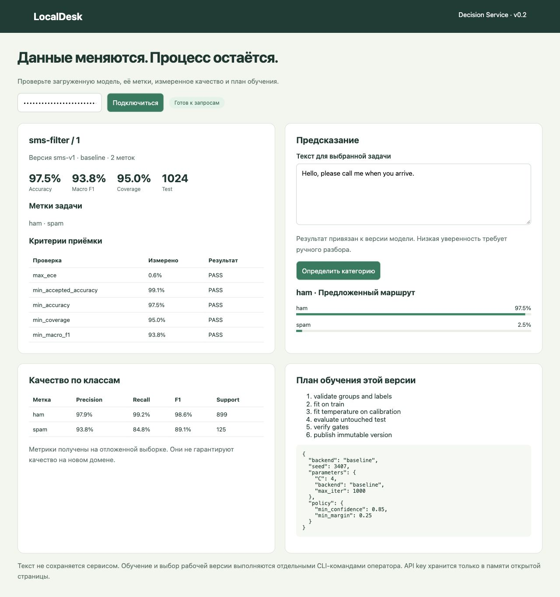
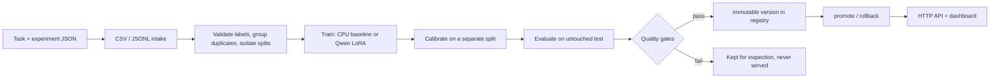

# LocalDesk

**Train a text classifier that knows when it isn't sure, and ship it with receipts.**

[](https://github.com/denis-samatov/localdesk/actions/workflows/ci.yml)

[](LICENSE)
[](https://colab.research.google.com/github/denis-samatov/localdesk/blob/main/notebooks/benchmark_qwen.ipynb)

LocalDesk turns a CSV or JSONL file and a JSON list of labels into a versioned,
calibrated classification service that runs locally. It is built for routing:
support tickets, intents, spam, triage queues. In those settings a confident
wrong answer costs more than asking a human.

- **Abstains instead of guessing.** Every prediction is either `route` or `review`,
  based on calibrated confidence and the margin between the top two labels.
- **Quality gates before deploy.** A version that misses your accuracy, macro-F1,
  calibration or coverage thresholds cannot be promoted or served.
- **Every version is reproducible and tamper-evident.** Each version is immutable
  and pins the task, the data fingerprints, the report and the training plan with
  SHA-256 checksums.
- **CPU first, LLM when it pays off.** The default model trains in seconds and needs
  only the Python standard library for inference. An optional Qwen + Unsloth LoRA
  recipe gave **+5.7 pp accuracy** over a tuned TF-IDF SVM on real IT tickets.



## Try it in 10 seconds

The package ships with a small model trained on real IT tickets. Running a
prediction has no runtime dependencies:

```bash
pip install "git+https://github.com/denis-samatov/localdesk.git"
localdesk predict "File share access request"
localdesk predict "I can't open the shared finance folder"
```

A clear request is routed. An ambiguous one goes to a human with the reason
attached (output abbreviated):

```jsonc
{"category": "Fileservice",     "action": "route",  "probabilities": {"Fileservice": 0.999, ...}, "review_reasons": []}
{"category": "Support general", "action": "review", "probabilities": {"Support general": 0.38, "Fileservice": 0.22, ...},
 "review_reasons": ["low_confidence", "small_margin"]}
```

Run `localdesk serve` to open the same model in a local web page at `http://127.0.0.1:8765`.

## Train on your own data (5 minutes)

**1. Describe the task.** The labels are yours; nothing in the core is IT-specific.

```json
{
  "id": "my-intents",
  "version": "1",
  "instructions": "Choose the intent of the message.",
  "labels": {
    "returns": "Requests to return a purchased item.",
    "delivery": "Questions or problems with delivery.",
    "other": "Other supported customer requests."
  },
  "min_confidence": 0.8,
  "min_margin": 0.2
}
```

**2. Point an experiment at your file and set the bar a model must clear.**

```json
{
  "task": "my-task.json",
  "dataset": {
    "path": "my-records.csv",
    "format": "csv",
    "text_column": "message",
    "label_column": "intent",
    "id_column": "id"
  },
  "registry": "my-registry",
  "training": {"backend": "baseline"},
  "gates": {"min_accuracy": 0.7, "min_macro_f1": 0.6, "max_ece": 0.1}
}
```

**3. Validate, train, promote, serve.**

```bash
git clone https://github.com/denis-samatov/localdesk.git && cd localdesk
pip install '.[baseline,service]'

localdesk validate my-experiment.json            # checks labels, leakage, class support
localdesk train my-experiment.json --run-id v1   # fit, calibrate, evaluate, gate
localdesk runs --registry my-registry            # list versions and gate results
localdesk promote v1 --registry my-registry      # refuses versions that failed gates
localdesk api --registry my-registry --anonymous-local
```

Paths are relative to the experiment file. JSONL supports dotted fields such as
`gold.category`, and you can supply explicit train/calibration/test files.
Unknown labels, conflicting duplicates, groups that cross splits and typos in the
configuration fail early with a clear message.

## Results on real public data

The commands and code are the same for both datasets. Only the configuration changes.

| Dataset | Labels | Test rows | Accuracy | Macro F1 | Auto-routed | Accuracy when routed |
| --- | ---: | ---: | ---: | ---: | ---: | ---: |
| [IT Support Tickets](https://zenodo.org/records/7648117) | 6 | 524 | 69.5% | 64.9% | 44.1% | **91.3%** |
| [UCI SMS Spam](https://archive.ics.uci.edu/dataset/228/sms+spam+collection) | 2 | 1024 | 97.5% | 93.8% | 95.0% | **99.1%** |

Both rows use the CPU baseline: hashed n-grams, logistic regression and temperature
calibration. "Accuracy when routed" covers only the requests the model handled
without asking a human. Training the IT model takes about 2 seconds on a laptop CPU.
To reproduce (the scripts download and checksum the public data):

```bash
python scripts/prepare_data.py && localdesk train experiments/it-support.json --run-id it-v1
python scripts/prepare_sms.py  && localdesk train experiments/sms-filter.json --run-id sms-v1
```

**Fine-tuned Qwen vs classic baselines** (same 524 IT test rows, free Colab T4):

| Method | Accuracy | Macro F1 | p50 latency |
| --- | ---: | ---: | ---: |
| Qwen 3.5 4B + LoRA (LocalDesk recipe) | **82.8%** | **80.6%** | 389 ms |
| TF-IDF + SVM (tuned) | 77.1% | 73.5% | 1.8 ms |
| TF-IDF + logistic regression | 77.7% | 74.0% | 2.1 ms |
| Qwen 3.5 4B zero-shot | 55.3% | 54.1% | 251 ms |

The accuracy gain over the SVM is +5.73 pp, with a paired-bootstrap 95% CI of
[+2.48, +9.16] pp. Macro-F1 gain is +7.06 pp, with a 95% CI of [+3.31, +11.10] pp.
Full protocol: [docs/BENCHMARK.md](docs/BENCHMARK.md) · report:
[reports/comparison-colab-it.md](reports/comparison-colab-it.md) ·
run it yourself: [Colab notebook](https://colab.research.google.com/github/denis-samatov/localdesk/blob/main/notebooks/benchmark_qwen.ipynb).

These are reused public holdouts, not a field trial. Measure on your own data
before relying on the numbers. [docs/VALIDATION.md](docs/VALIDATION.md) lists
exactly what was and wasn't verified.

## How it works



- **No leakage by construction.** Records that share a conversation or produce
  identical model features are grouped together, and a group never spans
  train/calibration/test.
- **Training and serving are separate processes.** The HTTP API cannot upload
  data, train or promote; it only answers predictions. Operators use the CLI.
- **Promotion is an atomic pointer swap.** Rollback is `localdesk promote <older-run>`.
  Workers verify every checksum on startup.

More detail: [architecture and contracts](docs/ARCHITECTURE.md) ·
[training plan](docs/TRAINING_PLAN.md).

## HTTP API

```bash
export LOCALDESK_API_KEY=change-me
localdesk api --registry my-registry          # or: docker compose up --build -d

curl http://127.0.0.1:8765/v1/predictions \
  -H "X-API-Key: $LOCALDESK_API_KEY" -H 'Content-Type: application/json' \
  -d '{"text": "Where is my parcel?"}'
```

| Endpoint | Purpose |
| --- | --- |
| `POST /v1/predictions`, `POST /v1/predictions/batch` | Decision, probabilities, model version and task hash |
| `GET /v1/model`, `/v1/model/report`, `/v1/model/plan` | Active labels, measured quality, gates and training plan |
| `GET /health/live`, `/health/ready` | Liveness; readiness only when a qualified model is loaded |
| `GET /metrics` | Prometheus counters (no request bodies are logged) |

Inference requests are queued and run one at a time, so a single process can
safely hold a GPU model. The API key is compared in constant time, bodies are
size- and time-limited, and anonymous mode accepts only loopback hosts and
origins. The Docker setup runs as a non-root user with a read-only filesystem
and models mounted read-only. See the [runbook](docs/RUNBOOK.md).

## Fine-tune Qwen with Unsloth (optional, CUDA)

Swap the `training` block and keep the rest of the pipeline:

```json
"training": {"backend": "unsloth", "epochs": 2, "rank": 16, "batch_size": 2,
             "gradient_accumulation": 4, "learning_rate": 0.0002}
```

The classification head is built from your label descriptions. Upstream
revisions are pinned in `requirements-gpu.txt`. Training stops on skipped or
truncated examples instead of silently degrading. Setup: [docs/TRAINING.md](docs/TRAINING.md).
GPU serving details: [docs/GPU_HTTP.md](docs/GPU_HTTP.md).

## Status

LocalDesk is **v0.2, early but tested**. CI runs lint, formatting, the test suite,
package build and a CLI smoke test on Linux, macOS and Windows with Python 3.11
and 3.13.

Current scope is single-label text classification on a single node. Not included
yet: multi-label targets, a hosted Qwen checkpoint you can download, multi-tenant
isolation, and hot-swapping models without a restart.

## Development

```bash
uv sync --frozen --extra dev --extra baseline --extra service
uv run pytest -q
uv run ruff check . && uv run ruff format --check .
```

Issues and pull requests are welcome. Please include a test for any change in behaviour.

## Documentation

[Architecture](docs/ARCHITECTURE.md) · [Runbook & API](docs/RUNBOOK.md) ·
[Datasets & provenance](docs/DATASETS.md) · [Training](docs/TRAINING.md) ·
[Benchmark protocol](docs/BENCHMARK.md) · [GPU HTTP check](docs/GPU_HTTP.md) ·
[Validation evidence](docs/VALIDATION.md)

## По-русски

LocalDesk превращает CSV/JSONL и список меток в калиброванный сервис классификации
текста с версиями и порогами качества. Модель отвечает «маршрутизировать» или
«на ручной разбор», если не уверена. Ядро не привязано к домену: меняются только
JSON-описание задачи и датасет. Обучение на CPU занимает секунды. Дообучение
Qwen через Unsloth дало +5,7 п.п. точности к сильному TF-IDF baseline на реальных
IT-заявках. Качество на других языках и в других организациях нужно измерять
отдельно.

## License

Code and notebooks: [MIT](LICENSE). The bundled demo model and benchmarks use
public datasets under CC BY 4.0; attribution is in [NOTICE.md](NOTICE.md).
Optional dependencies and model weights keep their own licenses.
