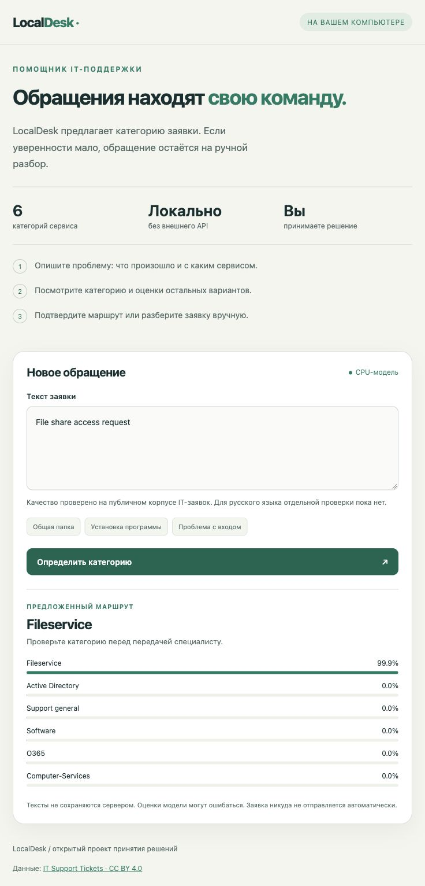

# LocalDesk

**Local IT ticket routing, trained on real human-labelled requests.**

A small support team can paste a request, inspect the proposed service category,
and keep uncertain cases for human review. The app runs on your computer, does
not store tickets, and never submits or acts on them automatically.

[](https://github.com/denis-samatov/localdesk/actions/workflows/ci.yml)
[](https://colab.research.google.com/github/denis-samatov/localdesk/blob/main/notebooks/train_qwen.ipynb)

The shipped **CPU baseline is actually trained**. The separate **Qwen3.5-4B /
Unsloth recipe has not been run on a GPU by this project**; its notebook is
syntax-checked and its adapter/data boundaries are tested with fakes. There are
no claimed Qwen accuracy, latency or VRAM results.



## Try it

Python 3.11 or newer; no GPU or API key needed. From a fresh clone:

```bash
git clone https://github.com/denis-samatov/localdesk.git
cd localdesk
python -m venv .venv
# macOS/Linux:
source .venv/bin/activate
# Windows PowerShell: .venv\Scripts\Activate.ps1
python -m pip install .
localdesk serve
```

Open `http://127.0.0.1:8765`. Command-line use:

```bash
localdesk predict "File share access request"
localdesk predict "Please install software on my computer"
```

The Russian interface accepts Unicode input. **Russian prediction quality is
unqualified**: the source corpus has no row-level language labels or dedicated
Russian benchmark. The source taxonomy comes from enterprise IT; deployment in
a school or library requires local labelled validation and a reviewed category map.

## Actual baseline results

The baseline uses SHA-256 hashed word/bigram counts, L2 normalization and a
multiclass logistic regression. It fits weights on **690** unique training
requests and a probability temperature on **170** separate calibration requests.
No fabricated requests are used for training or model evaluation.

On the **524** cleaned, held-out real requests:

| Metric | Measured result |
| --- | ---: |
| Category accuracy | 69.47% |
| Macro recall | 64.47% |
| Majority-class reference | 34.73% |
| Expected calibration error, 10 bins | 0.0368 |
| Automatically proposed routes | 231 / 524 (44.08%) |
| Accuracy within proposed routes | 211 / 231 (91.34%) |
| Requests kept for human review | 293 / 524 |

The fixed policy proposes a route only when the largest probability is at least
0.75 and its margin over the second option is at least 0.20. These are illustrative
settings, not guarantees or thresholds validated for a particular organization.
Overall accuracy and accepted-route accuracy are different measures: **91.3%
does not describe all requests**. Softmax confidence is not proof of correctness,
and these results are not a field trial.

Exact metrics, class recalls, data hashes, model hash and limitations:
[reports/baseline.json](reports/baseline.json).

## Real data and leakage audit

Source: [Classification of IT Support Tickets](https://doi.org/10.5281/zenodo.7648117),
Leonardo Santiago Benitez Pereira, 2022, v2, **CC BY 4.0**. The source describes
2,229 real requests classified by three IT professionals and anonymized by the
authors. It contains mainly English, German, Portuguese and Spanish text.
See [NOTICE.md](NOTICE.md) and [the data card](data/README.md).

The actual source labels differ from labels advertised by some third-party demos.
We inspect the CSV labels directly and preserve their names:

- Active Directory
- Computer-Services
- Fileservice
- O365
- Software
- Support general

The seventh source label, `EOL`, has only **two distinct automated ticket
texts** among 103 rows; both texts occur in official train and test. It cannot
support three disjoint splits. We reserve its two texts as an unsupported-category
challenge rather than inventing training samples. Both receive review in the
baseline, but two templates cannot establish general out-of-domain detection.

The pipeline joins X/y files by source ID and verifies four pinned SHA-256 hashes.
It finds **33 normalized text groups crossing the original train/test split**
before preprocessing. After grouping by the actual hashed input features,
there are **43** cross-split groups and **two** conflicting-label groups.
It excludes conflicting groups,
keeps one representative per preprocessing-equivalent group, and removes training copies of
all equivalent official test inputs. The shared feature recipe applies NFKC,
removes PII placeholder tags, tokenizes and builds hashed word/bigram features.
The split signature uses their L2-normalized values rounded to 12 decimal places.
This conservatively groups identical model representations as well as raw duplicates. Calibration is stratified from the remaining source
training pool. The cleaned benchmark therefore differs from the original
paper's protocol. We do not claim to reproduce or outperform the paper.

Only data manifests and the learned hashed-feature weights are committed.
Ticket text downloads and prepared splits are ignored by Git. Preparation is
reproducible:

```bash
python scripts/prepare_data.py
localdesk evaluate
```

The source has category labels only. `route`/`review` are application policy;
we do not fabricate gold labels for urgency, clarification or suggested actions.

## Train your decision model

The [original Colab notebook](notebooks/train_qwen.ipynb) downloads this same
verified dataset, trains Qwen3.5-4B with the Unsloth decision head and LoRA,
calibrates on separate data, tests and saves a local adapter with provenance.
The starting point is the [official Unsloth decision-model guide](https://unsloth.ai/docs/basics/train-your-own-decision-model-with-unsloth).

Follow [docs/TRAINING.md](docs/TRAINING.md) for the pinned source revisions,
CUDA setup, precision policy and saved-checkpoint inference. A free Colab GPU
is subject to availability and quotas. No fixed memory requirement is asserted.
The GPU recipe is a starting point, not a qualified GPU environment.

After training, with adapter and base model already present locally:

```bash
localdesk serve --backend unsloth --model artifacts/qwen-localdesk
localdesk predict --backend unsloth --model artifacts/qwen-localdesk "File share access request"
```

Model loading is explicitly offline. Errors in the Qwen mode are reported,
with no silent switch to the baseline. The baseline remains available as a
comparison on the identical cleaned test protocol.

## Reproduce the CPU baseline

```bash
python -m pip install '.[baseline]'
python scripts/prepare_data.py
python scripts/train_baseline.py
localdesk evaluate
```

This regenerates `src/localdesk/assets/baseline.json.gz` and
`reports/baseline.json`. Training verifies that the exported standard-library
scorer matches scikit-learn logits on the calibration set. Runtime inference
does not require NumPy, SciPy or scikit-learn. Different platforms can produce
small floating-point differences; the dataset hashes and recipe are fixed.

## Development

```bash
python -m pip install '.[dev]'
pytest -q
ruff check .
ruff format --check .
python -m build
```

Or `uv sync --frozen --extra dev` and `uv run --frozen --extra dev pytest -q`.
CI runs on Linux, Windows and macOS with Python 3.11 and 3.13. GPU training is
outside this CI. See [docs/VALIDATION.md](docs/VALIDATION.md) for local evidence.

The local HTTP server binds only to 127.0.0.1. It bounds request size, validates
option sets and probabilities, rejects unexpected fields and browser cross-origin
POSTs, and renders returned strings as text. It uses no external UI assets,
telemetry, database, localStorage or request-body logging. Initial installation,
data preparation and GPU training download public dependencies/data/weights.
The server is a local tool, not a production multi-user web service.

## По-русски

LocalDesk помогает небольшим IT-командам сортировать обращения: предлагает
категорию или оставляет заявку для ручного разбора. В комплекте — обученная
CPU-модель на **реальном публичном датасете**, локальный интерфейс, тесты и
Colab для обучения Qwen. Точность CPU-модели на всей очищенной тестовой выборке
— **69,47%**. Обучение Qwen на GPU и качество русского языка пока не подтверждены.
Запуск после установки: `localdesk serve`.

## License

Project code and original notebook: MIT. Dataset: CC BY 4.0 with attribution and
transformation details in [NOTICE.md](NOTICE.md). Optional dependencies and model
weights retain their respective upstream licenses.
