# LocalDesk Decision Service

**Configure a text dataset and its labels. Validate, train, calibrate, evaluate,
version and serve it through the same pipeline.**

LocalDesk is a modular decision service with a FastAPI inference boundary,
immutable model registry, quality gates, an operator dashboard and a training CLI.
Task definitions and column mappings live in JSON. IT ticket categories are an
example configuration, not the service's class vocabulary.

[](https://github.com/denis-samatov/localdesk/actions/workflows/ci.yml)
[](https://colab.research.google.com/github/denis-samatov/localdesk/blob/main/notebooks/train_qwen.ipynb)

## Architecture

```mermaid
flowchart LR
  C[Experiment + TaskSpec] --> D[CSV / JSONL intake]
  D --> V[Validate labels + isolate groups]
  V --> T[CPU or Qwen trainer]
  T --> K[Calibration split]
  K --> E[Untouched test + metrics]
  E --> G[Declared quality gates]
  G --> R[Immutable version registry]
  R --> P[Explicit promotion / rollback]
  P --> A[ASGI API + operator dashboard]
```



Training and serving are separate processes. Model weights carry their own
label schema; every response identifies its task hash and model version.
Failed training cannot publish a completed artifact. Ungated or failed-gate
candidates remain inspectable but cannot be activated or served. Model, report
and dataset fingerprints must agree on load. Activation updates an atomic
pointer; workers load a verified immutable snapshot at startup and restart to
adopt a new active version.

See [architecture and contracts](docs/ARCHITECTURE.md),
[training plan](docs/TRAINING_PLAN.md), [API/runbook](docs/RUNBOOK.md) and
[validation evidence](docs/VALIDATION.md).

## Run the complete lifecycle

Python 3.11 or 3.13:

```bash
git clone https://github.com/denis-samatov/localdesk.git
cd localdesk
python -m venv .venv
# macOS/Linux: source .venv/bin/activate
# Windows PowerShell: .venv\Scripts\Activate.ps1
python -m pip install '.[baseline,service]'

python scripts/prepare_data.py
localdesk validate experiments/it-support.json
localdesk train experiments/it-support.json --run-id it-v2
localdesk promote it-v2
localdesk api --anonymous-local
```

Open `http://127.0.0.1:8765` and click **Подключиться**. The dashboard displays
the active task, its actual labels, measured quality, gates and training plan.
It accepts requests and renders the corresponding probability distribution.
Anonymous mode is explicitly restricted to loopback peers, hosts and origins.

For authenticated serving, set `LOCALDESK_API_KEY` in the environment and omit
`--anonymous-local`. The direct ASGI factory requires a key independently of CLI:

```bash
uvicorn localdesk.api:application --factory --host 127.0.0.1 --port 8765 --no-access-log
```

This starts only an inference service: it cannot upload datasets, execute code,
train models or promote versions through HTTP. Operator actions use the CLI.
Use [the runbook](docs/RUNBOOK.md) for Docker, remote exposure and rollback.


## Replace the dataset and label set

A task file defines the new vocabulary:

```json
{
  "id": "my-intents",
  "version": "1",
  "instructions": "Choose the intent of the message.",
  "labels": {
    "returns": "Requests to return a purchased item.",
    "delivery": "Questions or problems with delivery.",
    "other": "Other supported customer requests."
  },
  "min_confidence": 0.8,
  "min_margin": 0.2
}
```

An experiment maps your data to that task:

```json
{
  "task": "my-task.json",
  "dataset": {
    "path": "my-records.csv",
    "format": "csv",
    "text_column": "message",
    "label_column": "intent",
    "id_column": "id"
  },
  "registry": "my-registry",
  "seed": 3407,
  "training": {"backend": "baseline", "C": 4.0, "max_iter": 1000},
  "gates": {"min_accuracy": 0.7, "min_macro_f1": 0.6, "max_ece": 0.1}
}
```

Paths are relative to the experiment file. Use the same commands:

```bash
localdesk validate my-experiment.json
localdesk train my-experiment.json --run-id my-v1
localdesk promote my-v1 --registry my-registry
localdesk api --registry my-registry --anonymous-local
```

No Python changes are needed for new text files, column names or 2–200 label
keys. JSONL supports dotted field paths such as `gold.category`. You may provide
explicit train/calibration/test files instead of one automatically split file.
Unknown labels, conflicting equivalent texts, overlapping groups, misspelled
configuration fields and insufficient class support fail with diagnostics.
New image modalities, regression outputs or multi-label targets require a
separate adapter; this release's contract is single-label text classification.

## Measured reuse on two real datasets

The same `localdesk train CONFIG` command was executed on both domains, followed
by exported-artifact loading and actual ASGI prediction requests. No fictional
training examples or invented metric labels were introduced.

| Real dataset | Labels | Train / calibration / test | Accuracy | Macro F1 | Route coverage | Accepted-route accuracy |
| --- | ---: | --- | ---: | ---: | ---: | ---: |
| IT Support Tickets | 6 | 690 / 170 / 524 | 69.47% | 64.92% | 44.08% | 91.34% |
| UCI SMS Spam Collection | 2 | 3334 / 768 / 1024 | 97.46% | 93.82% | 95.02% | 99.08% |

These are **CPU logistic-regression results** with separately fitted temperature
calibration. Coverage is the share receiving a route proposal; accepted accuracy
does not describe all requests. The corpus age, organization/language coverage,
exact-feature grouping and random/source splits limit real-world generalization.
A measured benchmark does not qualify a new organization's deployment.

Reports include accuracy, macro/weighted F1, confusion matrix, per-class
precision/recall/F1/support, NLL, Brier, ECE, acceptance coverage/accuracy,
data fingerprints and passed/failed gates. See [reports/service-reuse.json](reports/service-reuse.json)
and [data provenance](docs/DATASETS.md).

Reproduce the second domain by changing configuration only:

```bash
python scripts/prepare_sms.py
localdesk validate experiments/sms-filter.json
localdesk train experiments/sms-filter.json --run-id sms-v1
localdesk promote sms-v1
localdesk api --anonymous-local
```

Original UCI texts are not committed or stored by the inference server.
The preparation adapter verifies the archive and text SHA-256 checksums.
Both data sources are CC BY 4.0; attribution and changes are in [NOTICE.md](NOTICE.md).

## Artifacts and serving

Each completed version has `task.json`, `dataset.json`, `training-plan.json`,
`report.json`, model payload and a checksummed `manifest.json`. Checkpoints
are created under a reserved staging directory. Failures keep a private failure
status without exception text or ticket content; completed versions are never
rewritten. The default registry is `artifacts/registry/`, ignored by Git.

```bash
localdesk runs
localdesk predict --model artifacts/registry/it-v2 "File share access request"
localdesk evaluate --model artifacts/registry/it-v2 --config experiments/it-support.json
localdesk promote it-v2  # Also the rollback operation to an earlier qualified version.
```

The shipped v0.1 CPU baseline remains available for backward compatibility via
`localdesk predict "File share access request"` and `localdesk serve`. The new
service uses explicitly trained, qualified registry versions. Existing local
HTTP aliases `/api/decide` and `/api/info` are retained.

## Qwen / Unsloth training

Replace the `training` block with Unsloth parameters (`backend: unsloth`,
`epochs`, `rank`, `batch_size`, `gradient_accumulation`, `learning_rate`) and
use the same task/data pipeline in a CUDA environment. Remove CPU-only `C`/`max_iter`. The head receives the configured label descriptions; no
fixed IT choices are inserted. Unsloth imports before PyTorch/Transformers,
source revisions are pinned, and skipped/truncated examples stop training.

[docs/TRAINING.md](docs/TRAINING.md) and the original Colab notebook explain
setup. **GPU training and saved-Qwen reload remain unexecuted here**. CPU results,
fake upstream-boundary tests and notebook syntax checks do not establish Qwen
quality, latency or VRAM requirements. The CPU Docker image does not include
the optional GPU stack.

## Development and validation

```bash
python -m pip install '.[dev,baseline,service]'
pytest -q
ruff check .
ruff format --check .
python -m build
```

With uv: `uv sync --frozen --extra dev --extra baseline --extra service`.
CI checks Linux, Windows and macOS with Python 3.11 and 3.13.
See [docs/VALIDATION.md](docs/VALIDATION.md) for executed evidence and remaining boundaries.

## По-русски

Это сервис с общим циклом обучения и оценки. Меняются JSON-описание задачи,
метки и датасет; код ядра остаётся прежним. Есть проверка данных, обучение,
калибровка, отчёт качества, реестр версий, приёмка модели, API, панель и Docker.
Замена домена проверена на реальных IT-заявках и SMS. GPU-обучение Qwen и
качество на новых языках требуют отдельного прогона.

## License

Project code and original notebook: MIT. Public datasets: CC BY 4.0.
Optional dependencies and model weights retain their respective licenses.
